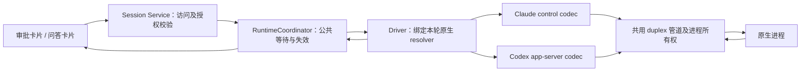

# vibe-kanban 原生交互源码调查与 Tower 建议

- 调查日期：2026-10-09。
- 外部源码：`BloopAI/vibe-kanban`，获取时 HEAD 为 **`d5cbb5380fa0b32e98ef9b8d987f63decce4be3a`**，commit 时间为 2026-09-19，标题 `fix: Tanstack router api fix (#3464)`。下文外部链接全部固定到此 SHA。
- Tower 对照基线：`51e9e7e7851b42159de403558343c7896aaf19b1`；对照现有 Claude CLI ASK 方案及 agent-tower-dev 的 Runtime/生命周期指导。
- 方法：在临时目录读取完整仓库源码，沿启动、协议、服务、日志投影、页面、答复和收尾追踪。没有运行模型、安装依赖、启动服务、修改产品实现或操作用户测试环境。
- 证据边界：以下“支持”指源码中存在完整处理路径，不代表已在 Tower 本机或所有上游版本实测成功。建议与潜在风险单独标明。

## 1. 先说结论

**它共用“登记一个等待用户答复的请求，再唤醒原生适配器”的后台与页面流程，但 Codex、Claude 分别实现自己的双向协议。** 审批与问答虽然共用一个叫 Approvals 的服务，结果类型仍然分开：审批是批准/拒绝，问答是答案数组。它没有把普通聊天消息当成正在执行的工具的答复。

| 问题 | 源码结论 |
| --- | --- |
| Codex 是否使用 app-server？ | 是，默认 `npx -y @openai/codex@0.124.0 app-server`，不是 `codex exec`。 |
| Codex 执行中问答是否真的接入？ | 是，处理 `ServerRequest::ToolRequestUserInput`，将答案还原为原生 question ID，再返回同一个 JSON-RPC request ID。 |
| Claude 是否保留双向 stdin？ | 是，直接持有 pipe 的 `ChildStdin`，逐条写入初始化、用户消息、控制响应和 interrupt。 |
| Claude 是否支持问答？ | 有 `AskUserQuestion` 的独立路径；但非 plan/approvals 配置明确带 `--disallowedTools=AskUserQuestion`，不能宣称所有配置都能问。 |
| 是否必须跨用户轮次常驻？ | 否。进程在本次 execution 中等待答复；普通 follow-up 新起进程并接续上下文。Codex 的计划批准、拒绝反馈、commit reminder 可以在同一 execution 内再起原生 turn。 |
| Tower 可借鉴什么？ | 共用等待、答复、取消、恢复；原生 ID/数据/结束语义留在适配器。Tower 已有 Coordinator，不应再并列新建另一套会话权威状态。 |

证据：[Codex 命令和问答条件][C1]、[Codex 原生请求处理][C3]、[Claude 命令/禁用条件][H1]、[Claude pipe 启动][H2]、[公共类型][S1]。

**不能直接照搬其权限实现。** Claude 在 plan/approvals 分支先以 `bypassPermissions` 启动，再发送 default/plan；模式设置只等待写入，不等待原生确认。计划批准还可写入 session bypass 权限。这与 Tower 的“未确认不得执行、不自动升权”要求不同。[H1]、[H2]、[H3]、[H4]

## 2. Codex 的完整链路

### 2.1 启动与原生协议

1. Executor 构建 `app-server` 命令，并创建独立 stdin/stdout/stderr pipe；stderr 与 JSON-RPC stdout 分离。[C1]、[C2]
2. `JsonRpcPeer` 保留 stdin，用互斥锁串行写一行 JSON 并 flush；stdout 按行解析 JSON-RPC request/response/notification。[C5]
3. `initialize` 广告 `experimental_api: true`，等待 InitializeResponse，之后发送 initialized；再创建 thread、调用 `turn/start`。普通续聊路径实际上用 **`thread/fork`** 从原 thread 派生新 thread，不是维持上一条进程连接。[C2]、[C6]
4. `build_thread_start_params` 在明确的非 Never 审批策略下设置 `features.default_mode_request_user_input=true`。因此 handler 存在不等于每种权限配置都会在 Default 模式发问。[C1]

原生版本依据：命令默认固定 Codex 0.124.0，Rust 协议依赖也固定 `rust-v0.124.0`；不是泛指所有 Codex。[C1]、[C10]

### 2.2 请求、标准化与页面

- 工具审批：分别处理 `FileChangeRequestApproval` 与 `CommandExecutionRequestApproval`，保留 `request_id`、用 `params.item_id` 关联工具。[C3]
- 用户提问：处理 `ToolRequestUserInput`；问题正文和选项来自 `params.questions`，不是从自然语言日志猜测。[C3]
- Client 通过 `ExecutorApprovalService` 创建 tool 或 question 请求，得到新的公共 `approval_id`，再写一条带 `call_id + approval_id` 的内部日志；随后等待对应 waiter。[C4]
- 独立的 Codex normalizer 将原生问题投影为 `ActionType::AskUserQuestion`，再用内部事件把工具状态标成 `PendingApproval { approval_id }`。[C7]、[C11]、[C12]
- 浏览器有两个来源：Approvals WS 提供“哪个 execution 正在等待”的元数据；normalized entries 提供问题正文/工具详情。`SessionChatBoxContainer` 按 approval ID 将两者拼接，再选择审批 UI 或问答 UI。[U1]、[U2]

问答 UI 可以逐题选择、输入自由文本，组件也支持多选；但 Codex 投影明确 `multi_select: false`，不能把 Claude 多选能力算到 Codex 上。[U3]、[C7]

### 2.3 用户答复如何送回同一轮

1. 页面调用统一 `POST /api/approvals/{approvalId}/respond`。审批传 approved/denied；问答传 `answered + [{ question, answer: string[] }]`。[U4]、[S2]
2. `Approvals.respond` 消费 pending 条目并通过 oneshot 唤醒 Client；协议转换仍由 Codex Client 做。[S3]、[C3]
3. 工具批准转为原生 Accept；拒绝通常转为 Decline，有文字反馈时转为 Cancel 并在 interrupted turn 后发送新反馈 turn；自动批准分支可能转为 AcceptForSession。[C8]
4. 问答将公共的 question-text→答案映射，按保留的原生 questions 还原为 `question_id → ToolRequestUserInputAnswer`；再以**原始 JSON-RPC request ID**返回。超时返回空 answers，不冒充批准。[C3]、[C9]

这条 `requestUserInput → answered → JSONRPCResponse` 是真正的执行中问答。工具审批接口及后续反馈新 turn 是另外两类行为。

### 2.4 收尾与缺失能力

- 常规 `turn/completed` 使 reader 结束并发送逻辑 exit signal；Container 收到信号后停止进程组。app-server 不需要自然退出才能完成执行。[C5]、[C9]、[L1]
- 计划批准、拒绝反馈或 commit reminder 可让 reader 继续，并在同一个 app-server 中发送新 turn；这仍不是普通用户 follow-up 永久复用进程。[C8]、[C9]
- 普通页面 follow-up 走另一条 Session API，创建新的 ExecutionProcess，再调用 `spawn_follow_up`。[F1]、[F2]
- 该版本对 MCP elicitation、额外 permissions approval 等 request 仅 warning 后返回 null；dynamic tool 返回 unsupported。没有发现完整支持所有 app-server 交互的实现。[C3]
- 没有发现 `serverRequest/resolved` 对当前 UI pending 的按请求失效处理，也未发现此路径的原生 `turn/interrupt` 调用；停止主要靠本次 execution 的 cancellation token 和进程组清理。不能据此宣称原生单请求取消/重连全覆盖。[C5]、[C9]、[L1]

## 3. Claude 的完整链路

### 3.1 启动与双向输入

默认命令固定 Claude Code 2.1.119，使用 `-p --input-format=stream-json --output-format=stream-json` 等参数。plan/approvals 分支加 `--permission-prompt-tool=stdio`；其余分支禁用 AskUserQuestion。[H1]、[H6]

Executor 直接 spawn 子进程并取出 ChildStdin/ChildStdout，`ProtocolPeer` 持有 stdin。它依次写 Initialize、SetPermissionMode、user message，保持输入开放；这不是终端 y/n，也不是官方 SDK 运行依赖，而是项目自己的 Rust 协议客户端。[H2]、[H3]

**必须区分写入与确认：**这里的 `initialize()` / `set_permission_mode()` 只调用 send_json。读循环没有将 ControlResponse 匹配回 pending，也没有等待初始化/模式 ACK；模式写入失败甚至只 warning 后继续发任务。[H2]、[H3]

### 3.2 原生请求如何进入公共等待

- PreToolUse hook 使用 `permissionDecision: ask`，引导 Claude 发出 can_use_tool；另有自动 allow 的 hook。它部分自行选择哪些工具需要询问，并非纯粹透传原生 default 审批。[H1]、[H4]
- `control_request(can_use_tool)` 被 ProtocolPeer 解析，保留 `request_id`，将 tool_name/input/tool_use_id 交给 ClaudeAgentClient。[H3]
- Client **先判断 AskUserQuestion**，调用 `handle_question()`；普通工具调用 `handle_approval()`。问答不会由普通自动批准分支替用户作答。[H4]
- 两条路径分别创建公共 tool/question approval，写 `ApprovalRequested { tool_call_id, approval_id }`，等待公共 waiter。[H4]、[S4]
- Claude normalizer 从原生 tool_use input 提取问题、选项和 multiSelect，投影为共用 AskUserQuestion action；内部 ApprovalRequested 关联 tool_use_id 并更新 PendingApproval 状态。后面使用与 Codex 相同的 WS、页面和答复 API。[H5]、[H9]、[U1]、[U2]、[U4]

### 3.3 原生答复与继续执行

- 批准普通工具：`PermissionResult::Allow { updatedInput: 原始工具输入 }`；拒绝：`Deny { message, interrupt: false }`；超时：Deny 且 interrupt true。[H4]
- 问答：把公共答案写入原始工具 input 的 `answers` 对象，再返回 Allow/updatedInput；Claude 继续执行 AskUserQuestion 工具并取得用户答案。这里的 allow 是问答传输容器，不能当成用户批准另一个危险操作。[H4]
- ProtocolPeer 把结果包装为 `control_response.success`，附**原始 request_id**，通过同一 stdin 写回。[H3]
- AskUserQuestion 缺 tool_use_id 时拒绝；普通工具缺 tool_use_id 时该实现却自动 allow。后者不适合 Tower 的受限模式。[H4]
- ExitPlanMode 的批准可附 updatedPermissions，把 session 改为 bypass；Tower 应把计划确认与权限变更分开，不复制该行为。[H4]

### 3.4 收尾与缺口

- ProtocolPeer 先记录 result，再退出 read loop；Claude SpawnedChild 没有逻辑 exit signal，Container 等 OS exit。[H2]、[H3]、[L1]
- **所有权推断，未实测：**启动任务释放自己的 peer 后，reader 是剩余 stdin owner；result 后 reader 结束会释放 stdin，产生 EOF，让 Claude 自然退出。代码没有独立显式 `endStdin()`/等待 ACK 的收尾契约。
- 普通 follow-up 新起进程，传 `--resume`，可传 `--resume-session-at`；双向输入不是跨用户轮次常驻的必要条件。[H8]、[F1]、[F2]
- 停止 token 到来时，公共等待先取消，reader 随后尝试向 Claude 发 interrupt；Container 最多等待 5 秒再清理进程组。[H3]、[S4]、[L2]
- 类型定义包含 ControlCancelRequest，但 ProtocolPeer 没有处理它；normalizer 也忽略它。当前读循环同步 await handle_control_request，等用户时无法继续读取此进程的取消、退出或其他 stdout 帧。[H3]、[H7]
- 没有发现 request_user_dialog 或通用原生对话的完整处理。当前支持点是 can_use_tool、hook_callback 和特定 AskUserQuestion，不是所有 SDK UI 交互。

## 4. 公共层实际负责什么

| 职责 | vibe-kanban 共用部分 | Agent 专属部分 | Tower 对应建议 |
| --- | --- | --- | --- |
| 请求类型 | tool/question 分开，统一 ApprovalOutcome | 判断原生是哪一种请求 | shared 增加独立问答类型；不塞进 permission optionId |
| 请求归属 | 新 UUID approval ID + execution_process_id | native request/item/tool_use ID 存于本次处理调用 | Coordinator 保留 session/turn/runtime generation；adapter 保存 native 映射 |
| pending 与等待 | DashMap + oneshot/shared future + deadline | Client 持有原生输入和待发送响应 | 延用 Coordinator 权威视图；Driver 持有原生 resolver |
| 内容展示 | 共用审批卡、问答 banner | Agent normalizer 提供工具/问题正文 | pending DTO 提供足够内容，不由历史日志决定可答复性 |
| 答复 HTTP | 同一路由，区分批准/拒绝/答案 | native payload 与 ID 转换 | 可共用处理框架，保留 typed response 和审批授权分支 |
| 原生通信 | 并未共用一个完整协议 peer | Codex JSON-RPC、Claude control protocol 各自实现 | 共用可靠 duplex pipe；各自 codec、handshake、cancel、completion |
| 断线恢复 | WS 首次快照、增量 patch、重连 | 没有恢复丢失 resolver 的原生协议 | 延用 GET runtime + Socket；不从日志复活旧请求 |
| 结束/停止 | Container 统一监控/清理进程组 | Codex logical signal；Claude result/EOF/interrupt | 保留 Tower logical turn、OS exit、tree cleanup 三个边界 |

公共 `Approvals` 保存 metadata 与 response sender，不保存问题正文/原生输入。Bridge 与 execution_process_id 绑定，create 和 wait 分开，用户可在 waiter 开始等待前答复而不丢结果。[S3]、[S4]

## 5. 编号、取消、重复、恢复与超时审视

| 场景 | 已找到的实现 | 限制/对 Tower 的意义 |
| --- | --- | --- |
| ID 关联 | 公共 UUID + execution_process_id；Client 保留 native request ID；工具通过 item_id/tool_use_id 关联日志 | pending 没有单独 turn/generation；Codex 多个内部 turn 可共享 execution。Tower 继续使用更严格的 turn/runtime 归属 |
| 重复/迟到答复 | pending.remove 只消费一次；completed 区分 AlreadyCompleted，未知 ID 返回 NotFound | API 统一映射成 500；没有请求级 responding/native write 状态。Tower 保留 409/403 区分和写入前二次失效检查 |
| 服务器答复校验 | 检查 tool/question status 类型 | req.execution_process_id 没有与 pending 比较；未保存/校验问题及选项 schema。不能把此入口当成 Tower 多用户授权参考 |
| HTTP 成功含义 | 服务发送 waiter outcome 即返回 | 发生在 adapter 写原生 stdin 之前。不能等同“原生已接收/工具已执行” |
| 主动停止 | cancellation token 取消等待；公共 pending 删除、WS 通知；Container 5 秒等待后杀进程组 | native 单请求取消未完整接入；不能只依赖 UI 禁用 |
| 等待超时 | 默认 **10 小时**；timeout watcher 删除 pending 并唤醒 waiter | 这是人类答复 deadline。启动 wrapper 的 30 秒超时不覆盖后台异步 handshake；Codex RPC await 没有独立固定超时 |
| 超时响应 | Codex 审批 Decline、问答空 answers；Claude Deny+interrupt | 这些语义需各 Agent 实测；不能自动允许 |
| 浏览器掉线/刷新 | WS 新连接发送当前快照；前端异常关闭后 1–8 秒退避重连；broadcast 落后重发快照 | 浏览器重连恢复的是后台仍存活的 pending，未中断原生 execution |
| 后台重启/native 断开 | pending/completed/waiter 均在内存 | 未发现跨后台重启恢复原生 pending 的机制；也不能用数据库旧 PendingApproval 日志继续答复 |
| 协议读取 | 两个 reader 都同步 await 请求 handler | 等用户期间会停止读取后续 stdout；原生 cancel/EOF 无法及时消费。Tower 应将读取 pump 与等待任务分离 |

上述服务行为见 [S1]、[S2]、[S3]、[S4]，浏览器恢复见 [U1]、[U5]，协议读取见 [C5]、[H3]，启动超时见 [L3]。范围是这条源码链路，不声称审计了项目全部认证中间件。

补充代码风险：Codex reader 结束后统一发送 Success；Container 甚至将 exit channel 关闭解释成成功。不能以此替代 Tower 已有的明确 completed/failed 和清理确认。[C5]、[L1]

问答身份也应改进：该实现以**问题文字**作为公共答案键，Codex 再还原原生 ID；相同文字可能碰撞，且投影没有完整保留 secret/其他输入约束。Tower 应使用稳定 questionId，答案按服务端保存的 schema 验证，而不是照搬 text-key。[C7]、[C9]、[U3]

## 6. 对 Tower 的可复用设计建议

当前 Tower 的事实：`DriverSession` 已有 runTurn/cancelTurn/resolvePermission；Coordinator 已维护 pendingPermissions、turnId、代际过滤与失效；GET runtime 是恢复权威入口。CLI permissions=false，Claude 使用一次 stdin 文件并禁用 AskUserQuestion，Parser 未处理 control 消息。**应扩展这些边界，避免独立搭第二套会话调度。**

1. **共用传输，保留专属协议。** 先前 Claude 方案的 pipe-duplex/可选 I/O handle 可以为 Codex app-server 复用：持续 stdin、独立 stdout/stderr、串行写、backpressure、断连、EOF、cleanup。Tower 现有 wrapper/launch claim/ownership/tree cleanup 必须保留。不能因 vibe-kanban 直接 spawn 就绕过 Tower 的进程清理门槛；也无需强行把它们套成 ACP。
2. **在现有 Coordinator 上补公共交互能力。** 审批保留现有 RuntimePermissionRequest/API 兼容路径；新增 typed question 请求/答案及等待原因或 pendingQuestions。公共负责一次消费、取消、当前 turn/runtime 校验与可恢复视图，Driver 负责原生 resolver。具体命名/API 路径可以后续确定，统一处理不要求所有请求使用相同结果字段。
3. **审批授权与问答分开。** ASK/AUTO_SANDBOX/FULL_ACCESS 只影响执行权限；FULL_ACCESS 不能自动回答“选择 A/B”。问答接口仍需 Session 访问校验。计划确认也不应自动修改权限。当前 resolveRuntimePermission 只是转发 Coordinator，未来审批答复资格复核需要显式接到 Service，不能误称现状已完成多用户答复授权。
4. **pending 内容由 Runtime 权威维护。** 不复制“WS 元数据 + 日志问题正文”的双来源依赖。直接在可恢复 runtime DTO 中提供有界、脱敏的问题/选项或工具摘要；原始 input 和 native resolver 在 Driver 内。历史日志可记录结果，不能恢复可点击的授权能力。
5. **编号贯穿全过程。** 使用 Tower requestId、questionId；内部绑定 `(sessionId, turnId, runtimeInstanceId/generation, nativeRequestId, nativeTurnId?, toolCallId?)`。pending→responding 必须原子；发送前再检查取消及 transport 身份；不确定是否送达的 allow 不重试/重放。回答不允许浏览器直接上传任意 native payload/updatedInput。
6. **读流持续消费。** 一个权威分帧入口分流日志与控制消息；收到请求后登记异步等待，不阻塞 pump。原生取消、停止、协议错误、EOF、新轮开始应使相关请求失效。保持有界帧和 pending 数量，不让审批控制输入暴露给 terminalInput。
7. **每轮进程完全可行。** 双向仅在本轮 active execution 内保留。Claude 收 result 后明确 finish/endStdin；Codex 收 turn/completed 后明确 finish，关闭/终止 transport。下一条用户消息在既有 admission/cleanup 完成后，新进程 resume/fork。跨轮常驻属于另一项优化，不是修复 ASK/askuser 的前提。

### 对原 Claude ASK 方案具体调整

- 保留推荐的 stdio/default、严格 handshake、resume 后重新确认权限、每轮新进程及整树 cleanup；vibe-kanban 的代码进一步支持这种通信方向，但不能当成本机版本验收。
- 将新 pipe-duplex 的职责描述改为**可供原生交互协议使用的传输能力**，名称/接口不要绑定 Claude；Claude codec 不负责公共等待状态。
- 当前任务若仍仅是 Claude ASK，可继续禁用 AskUserQuestion，先完成审批纵向切片；但 shared/Coordinator 的设计要允许独立 question 变体。真正开放 Claude 问答要单独验收 tool input/answer/resume，不能只删除 disallowedTools。
- 不复制 bypass 启动、hook 自动 allow、缺 tool ID 自动 allow、计划批准后 bypass 的策略；原生 default 必须在首个用户任务前得到可靠确认。
- Codex askuser 要接 app-server 初始化、thread/turn、原生问答和结束事件；保持 `codex exec` stdin 打开不足以达到同一效果。现有 Codex exec parser不能原封不动解析 app-server 日志，需专属协议/投影适配。

### Tower 现状定位（相对仓库根目录）

| 文件 | 本次定位 |
| --- | --- |
| `packages/shared/src/types.ts:94` | RuntimeCapabilities、Permission DTO、pendingPermissions；尚无 question contract |
| `packages/server/src/runtime/contracts.ts:14` | stream event、DriverSession、权限 resolver |
| `packages/server/src/runtime/runtime-coordinator.ts:294` | 答复活跃性/option 校验；695 pending 状态；749 失效；769 恢复视图 |
| `packages/server/src/runtime/acp/acp-driver.ts:264` | ACP resolver 一次消费；843 注册原生等待；893 取消 |
| `packages/server/src/runtime/cli-driver.ts:84` | CLI permissions=false；每轮 spawn 与 cleanup ownership |
| `packages/server/src/services/session-manager.ts:610` | 当前答复直接委托 Coordinator；1243 启动授权入口 |
| `packages/server/src/routes/sessions.ts:381` | GET runtime；399 permission resolve，错误目前转 409 |
| `packages/server/src/executors/base.executor.ts:651` | stdin 临时文件启动 |
| `packages/server/src/utils/process-launch.ts:577` | pipe-file wrapper；657 pipe 文件后关闭 stdin |
| `packages/server/src/executors/claude-code.executor.ts:229` | stream-json 与禁用 AskUserQuestion；320 单次 stdin spawn |
| `packages/server/src/output/claude-code-parser.ts:242` | 日志分类，没有 control handling；550 result 处理 |
| `packages/web/src/components/agent/RuntimePermissionPrompt.tsx` | 已有公共审批卡片；未来问答用不同呈现 |

## 7. 验证缺口与下一步

本次完成了源码调查，未运行外部项目测试、编译、真实模型或长期服务；只新增本报告。已经发现 Codex normalizer 的问答投影测试，但静态代码/单元测试存在不证明真实双向往返成功。

进入实现时先用模拟原生进程验证公共 duplex、持续读流、multiple pending、重复/迟到答复、native cancel、write failure、result/EOF 和整树 cleanup；再用独立临时环境做 Claude ASK 及 Codex requestUserInput 的有界真实 smoke。重点核实：

- Tower 当前实际 Claude/Codex 版本是否接受相同原生协议；不要将 vibe-kanban 的 Claude 2.1.119 / Codex 0.124.0 支持推到本机或未来版本。
- 初始化/权限模式确认、恢复旧 FULL_ACCESS 后 ASK 的实际生效；协议/模式错误不得降级或继续执行。
- FULL_ACCESS 下问答工具是否真实可触发、Default/Plan 与 feature 条件；开 handler 不等于 native 一定发问。
- 原生 request cancellation、turn 完成与迟到 HTTP 竞态；stop 后不能把旧答案送到新进程。
- 浏览器刷新恢复完整 pending；后台重启后不复活旧 resolver；明确区分答复已接收、写入原生、工具执行结果。
- Windows/Linux/Electron 与 wrapper IPC、stderr 隔离、认证/session 路径；不改用户全局设置。

建议由负责人先确认“只落地 Claude ASK，公共结构为问答预留”还是“同一范围同时接 Codex askuser”。本次没有派活、合并、发布或替用户决定扩大实施范围。

[C1]: https://github.com/BloopAI/vibe-kanban/blob/d5cbb5380fa0b32e98ef9b8d987f63decce4be3a/crates/executors/src/executors/codex.rs#L446-L528
[C2]: https://github.com/BloopAI/vibe-kanban/blob/d5cbb5380fa0b32e98ef9b8d987f63decce4be3a/crates/executors/src/executors/codex.rs#L564-L760
[C3]: https://github.com/BloopAI/vibe-kanban/blob/d5cbb5380fa0b32e98ef9b8d987f63decce4be3a/crates/executors/src/executors/codex/client.rs#L303-L441
[C4]: https://github.com/BloopAI/vibe-kanban/blob/d5cbb5380fa0b32e98ef9b8d987f63decce4be3a/crates/executors/src/executors/codex/client.rs#L456-L553
[C5]: https://github.com/BloopAI/vibe-kanban/blob/d5cbb5380fa0b32e98ef9b8d987f63decce4be3a/crates/executors/src/executors/codex/jsonrpc.rs#L59-L272
[C6]: https://github.com/BloopAI/vibe-kanban/blob/d5cbb5380fa0b32e98ef9b8d987f63decce4be3a/crates/executors/src/executors/codex/client.rs#L111-L170
[C7]: https://github.com/BloopAI/vibe-kanban/blob/d5cbb5380fa0b32e98ef9b8d987f63decce4be3a/crates/executors/src/executors/codex/normalize_logs.rs#L829-L886
[C8]: https://github.com/BloopAI/vibe-kanban/blob/d5cbb5380fa0b32e98ef9b8d987f63decce4be3a/crates/executors/src/executors/codex/client.rs#L566-L808
[C9]: https://github.com/BloopAI/vibe-kanban/blob/d5cbb5380fa0b32e98ef9b8d987f63decce4be3a/crates/executors/src/executors/codex/client.rs#L852-L961
[C10]: https://github.com/BloopAI/vibe-kanban/blob/d5cbb5380fa0b32e98ef9b8d987f63decce4be3a/crates/executors/Cargo.toml#L39-L40
[C11]: https://github.com/BloopAI/vibe-kanban/blob/d5cbb5380fa0b32e98ef9b8d987f63decce4be3a/crates/executors/src/executors/codex/normalize_logs.rs#L1227-L1269
[C12]: https://github.com/BloopAI/vibe-kanban/blob/d5cbb5380fa0b32e98ef9b8d987f63decce4be3a/crates/executors/src/executors/codex/normalize_logs.rs#L1496-L1541
[H1]: https://github.com/BloopAI/vibe-kanban/blob/d5cbb5380fa0b32e98ef9b8d987f63decce4be3a/crates/executors/src/executors/claude.rs#L148-L258
[H2]: https://github.com/BloopAI/vibe-kanban/blob/d5cbb5380fa0b32e98ef9b8d987f63decce4be3a/crates/executors/src/executors/claude.rs#L620-L710
[H3]: https://github.com/BloopAI/vibe-kanban/blob/d5cbb5380fa0b32e98ef9b8d987f63decce4be3a/crates/executors/src/executors/claude/protocol.rs#L22-L219
[H4]: https://github.com/BloopAI/vibe-kanban/blob/d5cbb5380fa0b32e98ef9b8d987f63decce4be3a/crates/executors/src/executors/claude/client.rs#L60-L379
[H5]: https://github.com/BloopAI/vibe-kanban/blob/d5cbb5380fa0b32e98ef9b8d987f63decce4be3a/crates/executors/src/executors/claude.rs#L1844-L1935
[H6]: https://github.com/BloopAI/vibe-kanban/blob/d5cbb5380fa0b32e98ef9b8d987f63decce4be3a/crates/executors/src/executors/claude.rs#L61-L66
[H7]: https://github.com/BloopAI/vibe-kanban/blob/d5cbb5380fa0b32e98ef9b8d987f63decce4be3a/crates/executors/src/executors/claude/types.rs#L8-L43
[H8]: https://github.com/BloopAI/vibe-kanban/blob/d5cbb5380fa0b32e98ef9b8d987f63decce4be3a/crates/executors/src/executors/claude.rs#L348-L381
[H9]: https://github.com/BloopAI/vibe-kanban/blob/d5cbb5380fa0b32e98ef9b8d987f63decce4be3a/crates/executors/src/executors/claude.rs#L1182-L1199
[S1]: https://github.com/BloopAI/vibe-kanban/blob/d5cbb5380fa0b32e98ef9b8d987f63decce4be3a/crates/utils/src/approvals.rs#L6-L77
[S2]: https://github.com/BloopAI/vibe-kanban/blob/d5cbb5380fa0b32e98ef9b8d987f63decce4be3a/crates/server/src/routes/approvals.rs#L21-L105
[S3]: https://github.com/BloopAI/vibe-kanban/blob/d5cbb5380fa0b32e98ef9b8d987f63decce4be3a/crates/services/src/services/approvals.rs#L20-L289
[S4]: https://github.com/BloopAI/vibe-kanban/blob/d5cbb5380fa0b32e98ef9b8d987f63decce4be3a/crates/services/src/services/approvals/executor_approvals.rs#L15-L177
[U1]: https://github.com/BloopAI/vibe-kanban/blob/d5cbb5380fa0b32e98ef9b8d987f63decce4be3a/packages/web-core/src/shared/hooks/useApprovals.ts#L16-L54
[U2]: https://github.com/BloopAI/vibe-kanban/blob/d5cbb5380fa0b32e98ef9b8d987f63decce4be3a/packages/web-core/src/features/workspace-chat/ui/SessionChatBoxContainer.tsx#L238-L272
[U3]: https://github.com/BloopAI/vibe-kanban/blob/d5cbb5380fa0b32e98ef9b8d987f63decce4be3a/packages/ui/src/components/AskUserQuestionBanner.tsx#L33-L155
[U4]: https://github.com/BloopAI/vibe-kanban/blob/d5cbb5380fa0b32e98ef9b8d987f63decce4be3a/packages/web-core/src/features/workspace-chat/model/hooks/useApprovalMutation.ts#L18-L53
[U5]: https://github.com/BloopAI/vibe-kanban/blob/d5cbb5380fa0b32e98ef9b8d987f63decce4be3a/packages/web-core/src/shared/hooks/useJsonPatchWsStream.ts#L54-L203
[L1]: https://github.com/BloopAI/vibe-kanban/blob/d5cbb5380fa0b32e98ef9b8d987f63decce4be3a/crates/local-deployment/src/container.rs#L478-L539
[L2]: https://github.com/BloopAI/vibe-kanban/blob/d5cbb5380fa0b32e98ef9b8d987f63decce4be3a/crates/local-deployment/src/container.rs#L1425-L1465
[L3]: https://github.com/BloopAI/vibe-kanban/blob/d5cbb5380fa0b32e98ef9b8d987f63decce4be3a/crates/local-deployment/src/container.rs#L1331-L1400
[F1]: https://github.com/BloopAI/vibe-kanban/blob/d5cbb5380fa0b32e98ef9b8d987f63decce4be3a/crates/server/src/routes/sessions/mod.rs#L124-L220
[F2]: https://github.com/BloopAI/vibe-kanban/blob/d5cbb5380fa0b32e98ef9b8d987f63decce4be3a/crates/executors/src/actions/coding_agent_follow_up.rs#L45-L93
